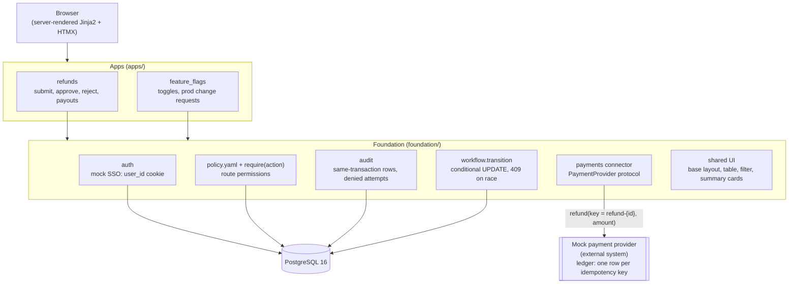
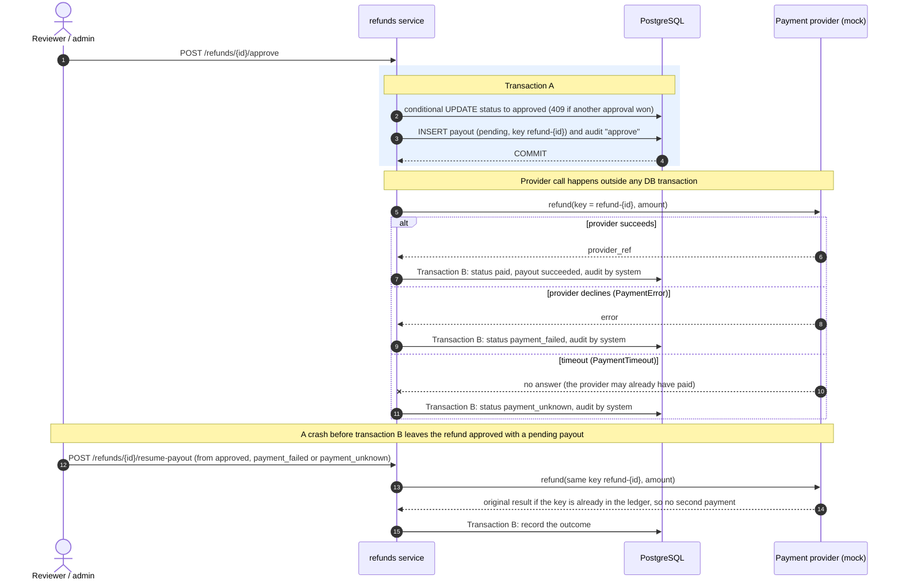
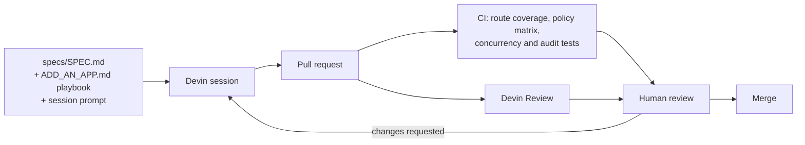

# devin-internal-tools-poc

## Description

An internal-tools foundation (auth, permissions, audit, workflow, payments connector and shared UI)
with two apps built on top of it: **refunds** and **feature flags**. Devin built it in a series of
spec-driven sessions as a proof of concept for replacing Power Apps with custom internal apps. The
full spec is in [specs/SPEC.md](specs/SPEC.md), and the playbook for adding an app is in
[specs/ADD_AN_APP.md](specs/ADD_AN_APP.md).

## How to run

**Prerequisites:** [Docker Desktop](https://www.docker.com/products/docker-desktop/) (or Docker
Engine with Compose v2).

```bash
docker compose up --build
```

Open **http://localhost:8000**. The app container runs the migrations
(`alembic upgrade head`) and seeds demo data before it starts. Postgres is exposed on host port
5433. To start again from a fresh database, run `docker compose down -v && docker compose up --build`.

**Switching users:** sign-in is mocked. Use the **Acting as** dropdown in the header, which sets a
`user_id` cookie. The seeded users are:

| User | Role | Can |
|---|---|---|
| alice, erin | agent | submit refunds |
| bob, frank | reviewer | approve or reject refunds up to $500, resume payouts |
| carol | admin | everything in refunds, including approvals over $500 and the provider demo control; approve or reject prod flag requests |
| dave, gwen | engineer | toggle dev/staging flags; request and approve prod flag changes |

**Running tests:** the tests run against Postgres, not SQLite, so the concurrency tests mean
something.

```bash
python3.12 -m venv .venv && .venv/bin/pip install -r requirements-dev.txt
docker compose up -d db
.venv/bin/pytest
```

The suite creates a `foundation_test` database if it is missing and migrates it to head. Set
`TEST_DATABASE_URL` to use a different database. CI ([.github/workflows/ci.yml](.github/workflows/ci.yml))
runs the same suite on every pull request against a Postgres 16 service. To lint, run
`.venv/bin/ruff check . && .venv/bin/ruff format --check .`.

## Architecture

### System



Apps own their models, rules, routes and templates. All permission checks, status changes and audit
writes go through the foundation. The mock provider keeps its ledger in its own table, written in
its own session, so it behaves like an external system that a rolled-back app transaction cannot
undo.

### Payout sequence



### Devin workflow



## Safeguards and the tests that prove them

| Rule | What is enforced | Test |
|---|---|---|
| Role permissions | Every non-public route declares a `require(action)` permission from `policy.yaml`; every route x role pair is checked | [tests/test_route_coverage.py](tests/test_route_coverage.py), [tests/test_policy_matrix.py](tests/test_policy_matrix.py) |
| No self-approval | The requester cannot approve or reject their own refund or prod flag request | [tests/refunds/test_rules.py](tests/refunds/test_rules.py) (`test_r2_...`), [tests/feature_flags/test_rules.py](tests/feature_flags/test_rules.py) (`test_self_approval_...`) |
| Admin over $500 | Only an admin can approve refunds over $500 | [tests/refunds/test_rules.py](tests/refunds/test_rules.py) (`test_r4_...`) |
| Two approvers over $1,000 | Two distinct approvers, neither the requester, one of them an admin; the first approval moves the refund to `partially_approved` | [tests/refunds/test_two_approvers.py](tests/refunds/test_two_approvers.py) |
| Balance lock | The transaction row is locked (`SELECT ... FOR UPDATE`) at submit, so refunds can't exceed the transaction, even concurrently | [tests/refunds/test_rules.py](tests/refunds/test_rules.py) (`test_r3_...`), [tests/refunds/test_concurrency.py](tests/refunds/test_concurrency.py) (`test_r3_...`) |
| Approval race | Conditional UPDATE: of two simultaneous decisions, exactly one wins and the other gets 409 | [tests/test_workflow.py](tests/test_workflow.py), [tests/refunds/test_concurrency.py](tests/refunds/test_concurrency.py) (`test_r5_...`), [tests/feature_flags/test_concurrency.py](tests/feature_flags/test_concurrency.py) |
| No double payout | Idempotency key `refund-{id}`; one ledger row per key, even with concurrent approvals or resumes | [tests/test_payments.py](tests/test_payments.py), [tests/refunds/test_payouts.py](tests/refunds/test_payouts.py), [tests/refunds/test_two_approvers.py](tests/refunds/test_two_approvers.py) (`test_concurrent_second_approvals_...`) |
| Crash/timeout recovery | A timeout gives `payment_unknown`, never `payment_failed`; resume after a crash or timeout reuses the key and pays once | [tests/refunds/test_payouts.py](tests/refunds/test_payouts.py) |
| Audit atomicity | A state change and its audit row commit or roll back together; the audit log is append-only | [tests/test_audit.py](tests/test_audit.py), [tests/refunds/test_audit_coverage.py](tests/refunds/test_audit_coverage.py), [tests/feature_flags/test_audit_coverage.py](tests/feature_flags/test_audit_coverage.py) |
| Denied-attempt logging | A 403 is written to the audit log in its own committed session, even if the request rolls back | [tests/test_audit.py](tests/test_audit.py) (`test_denied_...`, `test_http_denial_...`), [tests/refunds/test_ui.py](tests/refunds/test_ui.py) (`test_htmx_403_...`) |
| Prod flag approval | Prod flags can't be toggled directly, even by an admin; an engineer's request must be approved by a different engineer or an admin | [tests/feature_flags/test_rules.py](tests/feature_flags/test_rules.py), [tests/feature_flags/test_concurrency.py](tests/feature_flags/test_concurrency.py) |

## Demo example flow

Start from a fresh database (`docker compose down -v && docker compose up --build`), open
http://localhost:8000 and switch users with the **Acting as** dropdown in the header.

1. **As alice (agent), submit a $120 refund.** Refunds → **New refund**, pick a transaction
   with at least $120 still refundable (e.g. *Lakeside Veterinary Clinic*), amount `120`, any
   reason, **Submit refund**. You land on the refund's page: status `submitted`, no payout yet.
2. **Try to approve it as alice — blocked.** Under *Actions*, alice has no permitted actions;
   click **Approve** in the "Not permitted for you" row. A red message explains that
   alice (agent) can't approve refunds and only reviewers and admins can; the status is unchanged and the attempt appears
   as a `denied` row in the refund's audit history.
3. **As bob (reviewer), approve it — paid.** Switch to bob on the same page and click
   **Approve**. Status `paid`, payout `succeeded`, 1 attempt, 1 payment in the provider ledger.
4. **As carol (admin), set provider mode to `timeout_after_success`; as bob, approve another
   refund — shows `payment_unknown`.** Switch to carol; in the orange **Demo control** box (on
   the dashboard and on every refund page) choose `timeout_after_success` → **Set mode**.
   Switch to bob, filter the dashboard by `submitted`, open any refund of $500 or less and
   click **Approve**: status `payment_unknown`, payout `unknown`, flagged *needs attention*.
   The provider ledger already shows 1 payment: the provider paid but never answered.
5. **As carol, set mode back to `ok`; resume the payout — paid, one payment in the ledger.**
   Switch to carol on that refund, set the mode to `ok`, click **Resume payout**. Status
   `paid`, payout `succeeded` after 2 attempts, and still **1 payment** for key `refund-<id>`:
   the retry reused the idempotency key, so the customer was not paid twice.
6. **Open the audit log and show the full history, including the blocked attempt.** As carol,
   click **Audit log** in the header: the `denied` row for alice's `refunds.approve` attempt is
   highlighted next to the submit, approve, `set_mode` and `payout_*` rows (payout outcomes are
   recorded as `system`, with the human in `triggered_by`). Each refund page shows the same
   history for that refund.
7. **Refunds over $1,000 need two approvers.** As bob, filter by `submitted` and open the
   *Summit Freight Logistics* refund ($1,280): click **Approve (1 of 2)** — status
   `partially_approved`, *Approvals: bob (1 of 2)*, no payout. bob's Approve is now disabled
   ("you gave the first approval"), and frank (reviewer) cannot give the second approval
   either, because one approver must be an admin. Switch to carol and click
   **Approve (2 of 2)**: status `paid`, *Approvals: bob, carol (2 of 2)*, 1 payment.
8. **Prod flag changes need a second person.** As dave (engineer), open **Flags**: dev and
   staging flags have **Turn on/off** buttons, but prod flags only offer **Request turn ...**.
   The seeded request to turn on prod `new_checkout` is dave's own, so its *Decision* column reads
   "your request: another engineer or an admin must approve it". Switch to gwen (engineer) and
   click **Approve**: prod `new_checkout` is now `on`, and *Recent flag activity* shows dave's
   request and gwen's approval.

## What this does not prove / not production-ready

- **Mocked SSO and payments.** Users are chosen with a cookie, and the payment provider is a mock with
  a database-backed ledger.
- **The provider mode is in memory.** The demo control's mode lives in the app process, so it only
  works with a single uvicorn worker.
- **No deployment, monitoring or alerting.** It runs locally with Docker Compose only.
- **No background payout reconciliation.** `payment_unknown` and `payment_failed` payouts wait for
  someone to click **Resume payout**.
- **No break-glass override for prod flags.** Every prod change needs a second approver, even in an
  incident.
- **No request withdrawal.** A requester can't cancel their own refund or flag request.
- **A `first_approved_by` column instead of a general approvals table.** It fits the two-approver
  rule only; N-of-M approvals would need a schema change.
- **No security review.** It hasn't had threat modeling, a penetration test or a dependency audit.

## Build log

Each step was one Devin session and one PR. Prompts are in
[specs/DEVIN_PROMPTS.md](specs/DEVIN_PROMPTS.md) and quoted in each PR description.

| Step | PR | What Devin built |
|---|---|---|
| 1 | [#2 Session 1: skeleton + CI](https://github.com/armitahj/devin-internal-tools-poc/pull/2) | FastAPI skeleton, Postgres 16 in Docker Compose, SQLAlchemy + Alembic, pytest against Postgres, GitHub Actions CI, `/health` |
| 2 | [#3 Session 2: foundation](https://github.com/armitahj/devin-internal-tools-poc/pull/3) | `foundation/`: cookie auth and user switcher, `policy.yaml` + `require()`, audit (same-transaction and denied), `workflow.transition`, mock payments connector, shared UI partials; route-coverage and policy-matrix tests |
| 3a | [#4 Session 3a: refunds backend](https://github.com/armitahj/devin-internal-tools-poc/pull/4) | Refunds models, rules R1-R7, two-transaction payouts with idempotency key and resume, seed data, concurrency and crash-recovery tests; a review follow-up attributed payout outcomes to `system` |
| 3b | [#5 Session 3b: refunds UI](https://github.com/armitahj/devin-internal-tools-poc/pull/5) | Dashboard with summary cards and filters, detail page with actions and history, submit form, admin provider demo control, readable HTMX errors, demo script |
| 4 | [#6 Session 4: feature flags (from playbook)](https://github.com/armitahj/devin-internal-tools-poc/pull/6) | Feature-flags app built from `ADD_AN_APP.md` on the unchanged foundation: direct dev/staging toggles and prod change requests that another person approves |
| 5 | [#7 Session 5: two-approver change request](https://github.com/armitahj/devin-internal-tools-poc/pull/7) | Refunds over $1,000 need two distinct approvers, with a new `partially_approved` status, migration, UI and tests (including concurrent second approvals paying once) |
| 6 | Session 6: README + cleanup | Neutral seed customer names; this README |

## Layout

- `foundation/` — shared package: auth, policy, audit, workflow, payments connector, UI partials
- `apps/` — FastAPI entrypoint (`apps/main.py`) and per-app packages (`apps/refunds/`, `apps/feature_flags/`)
- `alembic/` — migrations
- `tests/` — foundation tests at the top level, per-app tests in `tests/refunds/` and `tests/feature_flags/`
- `specs/` — spec, add-an-app playbook and session prompts
